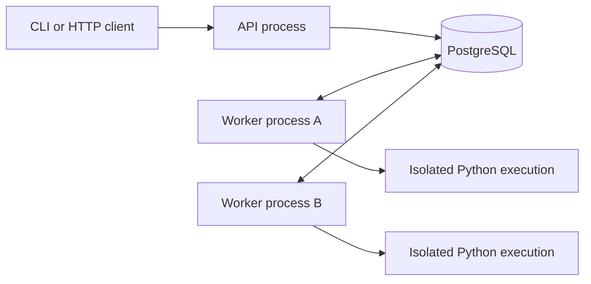

# TaskForge — A Distributed Online Code Judge

## 1. Purpose

TaskForge is a backend portfolio project for a graduating student interested in backend engineering and system design. It accepts programming submissions through an API, evaluates them in isolated Linux environments, and returns durable results.

The project draws on my competitive programming background through A2SV. The example use case is a small university training session: submissions arrive in bursts, execution takes time, and one resource-intensive program must not block everyone else.

The objective is a small, working system whose behavior I can demonstrate and explain: database transactions, asynchronous APIs, bounded concurrency, worker coordination, failure recovery, and performance tradeoffs.

This is a medium-sized systems project when all four phases are included. Each phase produces a smaller demonstrable result. The complete MVP is reached after Phase 3; Phase 4 makes its behavior measurable and its portfolio presentation reproducible.

## 2. Scope

### Included in the MVP

- Three fixed problems: sum two integers, sum a list, and check balanced brackets.
- A fixed, ordered test suite for each problem.
- Python 3 submissions only; Rust implements the judge itself.
- Problem retrieval, submission creation, and submission status APIs.
- PostgreSQL storage for problems, test cases, submissions, jobs, and eventually attempts.
- Independent API and worker processes in one repository.
- A configurable number of execution slots per worker.
- At least two independent workers in the reliability demonstration.
- An established sandbox, with verified restrictions and resource limits.
- Atomic job acceptance, bounded backlog, expiring worker leases, bounded retries, and protection against stale results.
- Structured logs, automated correctness checks, and reproducible measurements.

### Deferred

Authentication, public anonymous hosting, a frontend, leaderboards, contest scheduling, problem authoring APIs, interactive problems, custom checkers, floating-point judging, multiple submission languages, compilation, priorities, autoscaling, database replication, Kubernetes, Kafka, a separate message broker, and a general-purpose job framework.

The MVP is a controlled local demonstration. Anyone with access to its API can submit and query submissions. Authentication and access control would require a separate phase before operating it as a shared public service.

## 3. Technology and Deployment

| Responsibility | Initial choice |
| --- | --- |
| API and workers | Rust |
| Async runtime and HTTP | Tokio and Axum |
| Persistence and durable queue | PostgreSQL and SQLx |
| Submission runtime | One pinned Python 3 version |
| Isolation | Isolate, subject to Phase 1 feasibility checks |
| Local dependencies | Docker Compose for PostgreSQL and the API |
| Worker execution | Native Linux worker processes initially |

Pin compatible tool and runtime versions during implementation and record them in the setup instructions. Rust remains the preferred implementation language. A language change is a scope decision to document before building, not a prerequisite for demonstrating backend design.

Workers run natively first because sandbox permissions, namespaces, and cgroup access must be verified on the actual host. A containerized worker is optional and must provide the same verified restrictions. Docker Compose is deployment tooling; it is not the security boundary for submitted programs.

Use an established sandbox rather than implementing Linux isolation from scratch. Do not silently fall back to running submissions as ordinary host processes if sandbox setup fails.

## 4. Architecture



### API

Validate requests, retrieve public problem information, admit submissions within capacity, and serve status/results. Do not execute submitted code in request handlers.

### PostgreSQL

Store the source of truth for accepted work, ownership, attempts, and final results. Insert a submission and its job in one transaction before acknowledging acceptance.

Start with a database queue. Workers claim eligible jobs using short transactions and `FOR UPDATE SKIP LOCKED`, then execute outside the transaction. PostgreSQL explicitly documents this option for consumers of queue-like tables. See the [SELECT documentation](https://www.postgresql.org/docs/current/sql-select.html).

A separate broker is deferred because it introduces another service and coordination between database writes and message publication. Revisit that decision only if measurements or requirements justify it.

### Workers

Acquire a local execution slot before claiming work. Load the fixed problem definition, invoke the runner, and publish results. In Phase 3, also renew leases, record attempts, and recover expired work through a periodic maintenance loop inside the worker process.

There is no separate scheduler service. Multiple workers may perform maintenance safely through database coordination.

### Runner

Own sandbox setup, execution, output collection, resource enforcement, verdict classification, and cleanup. Keep its interface independent of HTTP and SQL. It receives test inputs, but expected outputs stay in the trusted judge process.

Use asynchronous I/O for network, database, and subprocess pipes. Submitted Python runs in a sandboxed OS process. Move genuinely blocking host operations away from Tokio's async executor.

## 5. Evaluation Contract

- A submission references one immutable seeded problem and its fixed test suite. Changing tests or limits requires a new problem identifier; in-place editing is outside the MVP.
- Execute tests in stored order, in a fresh sandbox per test. Stop at the first failing test.
- Compare stdout and expected output as sequences of byte tokens separated by ASCII whitespace. Tokens must match exactly; no numeric tolerance or custom checker.
- Enforce CPU time, wall time, memory, process count, output bytes, and filesystem/network restrictions. Phase 1 verifies the exact configuration.
- Python has no separate compilation stage. Syntax errors are Runtime Error in this MVP.
- User-code outcomes are final evaluations, not retryable infrastructure failures.

| Verdict | Meaning |
| --- | --- |
| Accepted | All tests passed. |
| Wrong Answer | Output tokens differ from expected tokens. |
| Time Limit Exceeded | A test exceeded its CPU or wall-time limit. |
| Memory Limit Exceeded | Sandbox evidence identifies memory-limit exhaustion. |
| Output Limit Exceeded | Combined stdout/stderr exceeded the configured byte limit. |
| Runtime Error | Submitted code failed without a more specific resource verdict. |
| Internal Judge Error | Infrastructure failed and no more retries are available. |

Never infer Memory Limit Exceeded from an unexplained signal alone. Never store unlimited output or expose hidden test inputs/expected outputs through the public API.

## 6. Data Model and Job Lifecycle

Phase 2 introduces these tables:

| Table | Responsibility |
| --- | --- |
| `problems` | Immutable public description, examples, runtime, and limits. |
| `test_cases` | Ordered private inputs and expected outputs for a problem. |
| `submissions` | Source, problem reference, acceptance timestamp, and eventual final result. |
| `jobs` | One job per submission; authoritative lifecycle state and scheduling metadata. |

Phase 3 adds `job_attempts` and lease fields. Attempts record individual execution histories without duplicating unbounded output.

```text
queued -> running -> completed
             |
             +-> queued       retryable failure or expired lease, attempts remain
             |
             +-> failed       infrastructure failure, attempts exhausted
```

`completed` includes Accepted, Wrong Answer, and all other user-code verdicts. `failed` publishes Internal Judge Error. `queued` and `running` have no final verdict. Publishing a result and moving the job to a terminal state occur in one transaction.

Phase 2 provides only the first execution attempt; automatic crash recovery is introduced in Phase 3. Intermediate demonstrations must state that limitation.

## 7. Reliability and Capacity Guarantees

These are acceptance criteria for the completed MVP, not claims about software that already exists:

1. A `202 Accepted` response means the submission and job have committed. Durability assumes the database and its configured storage remain intact; host/storage disaster recovery is outside scope.
2. Work may execute more than once following a failure. Do not promise exactly-once execution.
3. Each claim has a unique attempt token and an expiring lease. Renewals and final writes require the current token and an unexpired lease, using database time.
4. A worker that loses ownership cannot publish a result. Conditional updates that affect no rows mean ownership was lost.
5. No database transaction stays open while submitted code executes.
6. Each job has a maximum of three claims, including the initial claim. Infrastructure retries use bounded delays; user-code verdicts are never retried.
7. Recovery requires a healthy worker and reachable database. Define and measure recovery delay from lease expiry; no availability guarantee is made during a database outage.
8. Each worker limits its own active attempts. Two workers with two slots each permit at most four currently owned attempts. Expired attempts may overlap temporarily with replacements; stale execution must be cancelled or terminated by a fixed attempt deadline.
9. Admission bounds unfinished submissions (`queued` plus `running`). Capacity checking and insertion must be coordinated across API instances, not implemented as an unprotected count followed by an insert.
10. A lost HTTP response after commit can lead a client to submit again. Client request deduplication is deferred; this differs from retrying an existing job.

## 8. Workload and Measurements

Distinguish queued submissions, concurrent API clients, and simultaneously executing programs. A burst of 100 accepted submissions does not imply 100 execution slots.

Initial settings are one worker/one slot, followed by two workers with one or two slots each. Benchmark on documented hardware before setting throughput or latency targets.

Measure API acceptance latency separately from queue waiting time, execution duration, and acceptance-to-terminal latency. Report throughput, p50/p95/p99 with sample counts, backlog, active slots, retries, and failures. Record workload composition, limits, runtime versions, worker count, and slot count with every report.

## 9. Implementation Phases

| Phase | Outcome | Detailed plan |
| --- | --- | --- |
| 1 | Verified sandbox runner and deterministic verdicts, without an API or database | [phase_1.md](phase_1.md) |
| 2 | Durable API-to-database-to-single-worker flow | [phase_2.md](phase_2.md) |
| 3 | Multiple workers, leases, retries, stale-result protection, and recovery | [phase_3.md](phase_3.md) |
| 4 | Benchmarks, failure demonstrations, and reproducible portfolio documentation | [phase_4.md](phase_4.md) |

Complete each phase's exit checks before moving to the next. This revision defines the implementation plan; no application code is included.

## 10. Portfolio Deliverables

- A setup guide that reproduces the local demonstration.
- A component diagram, schema, lifecycle, and short decision records for consequential choices.
- Correctness tests for verdicts, atomic acceptance, ownership, retry bounds, and capacity.
- Demonstrations of crash recovery and rejection of an expired worker's result.
- A benchmark report showing how throughput changes with worker capacity and where it stops improving.
- An honest account of limitations: shared host resources, a single database, local deployment, sandbox assumptions, and omitted product features.

Design for understandable modules, not speculative reuse. Extracting the queue for other workloads is an optional extension after these deliverables are complete.

## 11. Working Agreement

Keep the project small enough to finish. For each phase, explain important decisions, implement only its scope, verify observable behavior, and update documentation to match the result. Prefer evidence over unsupported scale or security claims.

Reference materials: [Isolate project](https://github.com/ioi/isolate), [Isolate manual and installation requirements](https://www.ucw.cz/isolate/isolate.1.html), and [PostgreSQL locking documentation](https://www.postgresql.org/docs/current/explicit-locking.html).
